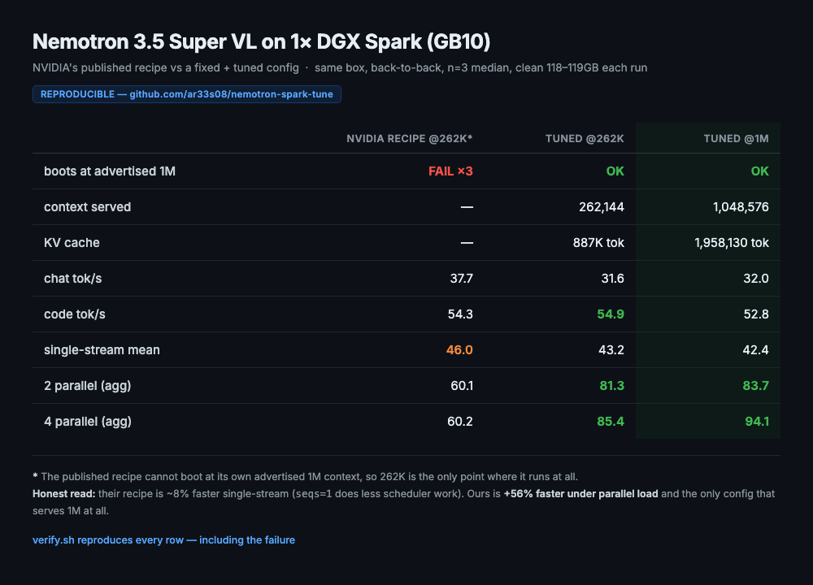

# Nemotron 3.5 Super VL on a single DGX Spark — it does not boot as shipped

**NVIDIA's published DGX Spark recipe for this model fails to start.** This repo
documents the root cause (traced to the source line), the one-flag fix, and the
tuning that follows once it boots.

Measured on **one** NVIDIA DGX Spark (GB10, 121 GB unified memory).

---

## TL;DR

```bash
# vendor recipe fails with: "Engine core initialization failed"
#
# FIX = disable video, which keeps your FULL 1M context:
--limit-mm-per-prompt '{"video":0,"image":1}'
```

Root cause: the processor hardcodes the encoder cache budget to the **entire
context length whenever video is enabled** (`nano_nemotron_vl.py:361-363`). So the
encoder tries to profile 1M tokens and OOMs once the 70 GiB of weights are resident.
Turning video off routes the encoder through the image-sizing path instead.

Result: boots at **full 1,048,576 context**, 1,958,130 tokens of KV cache,
1.87x concurrency, 51.8 tok/s code.

> Alternative if you need video: keep `--max-model-len 262144`. That also boots,
> with 887,377 tokens of KV cache at 3.39x concurrency, but you lose 75% of context.

## The bug

NVIDIA's DGX Spark config leaves `max_model_len` at the model's advertised 1M.
The **encoder hardcodes its cache budget to the whole context whenever video is
enabled**:

```
nano_nemotron_vl.py:361-363
    if mm_counts.get("video", 0) > 0:
        mm_max_tokens["video"] = seq_len        # seq_len == max_model_len
encoder_budget.py:29   -> get_mm_max_tokens_per_item(seq_len = max_model_len)
encoder_runner.py:131  -> "Encoder cache will be initialized with a budget of 1048576 tokens"
```

At 1M the encoder tries to profile **1,048,576 tokens**. Once the 70 GiB of
weights are resident, a 128 MiB allocation fails with ~700 MiB free, the
allocator spins in a retry loop, and the engine dies:

```
memory allocation failed with OOM on device 0 while trying to allocate 134217728 bytes
  (free: 740929536, total: 130663231488)
...
RuntimeError: Engine core initialization failed. See root cause above.
```

It never even reaches KV cache allocation.

### The two fixes (both verified)

| goal | flag | result |
|---|---|---|
| **full 1M context** | `--limit-mm-per-prompt '{"video":0,"image":1}'` | boots, 1,958,130 tok KV, 1.87x conc |
| keep video | `--max-model-len 262144` | boots, 887,377 tok KV, 3.39x conc |

Disabling video makes `mm_counts["video"] == 0` so the encoder sizes from images
instead of the full context. You lose video understanding but keep every token of
context the model advertises.

### What does NOT fix it (all measured)

| attempt | result |
|---|---|
| `--gpu-memory-utilization` 0.80 → 0.78 → 0.72 → 0.70 | **no effect** |
| `--gpu-memory-utilization` 0.92 with 1M | fails *earlier*: `Free memory (109.5 GiB) < desired (111.95 GiB)` |
| `--max-num-batched-tokens` 8192 → 4096 → 2048 | **no effect** (budget stayed 1048576) |
| `--mm-processor-kwargs '{"num_frames":64}'` | `TypeError` — not a real kwarg |
| `--mm-processor-kwargs '{"video":...}'` | `TypeError` — processor takes flat keys only |
| `--mm-processor-kwargs '{"max_num_tiles":1,"video_pruning_rate":0.9}'` at 1M | still OOMs |
| restarting / retrying | same failure every time |

The encoder budget is driven purely by `seq_len` (context) **while video is on**.
Only two things move it: lower the context, or remove video from the mix.

### Two related landmines found on the way

1. **Swap spill.** Stock `min_free_kbytes` is ~44 MB and `swappiness` is 60, so the
   kernel pages the model out rather than keeping it resident. Proof: swap usage
   went **9989 MB → 129 MB** across a teardown. `config/tuned.sh` dirties and frees
   an 8 GB buffer before launching to force reclamation (no root needed).

2. **`--gpu-memory-utilization` is a SYSTEM setting on unified memory.** It is a
   slice of the whole 121 GB shared with the OS, not dedicated VRAM. At 0.85 it
   pins ~108 GB unswappable and the box wedges: `ping` works, TCP to :22 still
   *accepts*, but `sshd` never sends its banner because it cannot fork. Recovery
   needs a physical power button. GB10 unified pages are not reclaimed on their own.

## The trade-off, stated honestly

**Two working configurations. Pick by what you need:**

| config | context | KV cache | when to use |
|---|---|---|---|
| video disabled | **1,048,576** (full) | 1,958,130 tok | long-context text + images |
| video enabled | 262,144 | 887,377 tok | you need video frames |

Full 1M comes at the cost of video. Both are ~equal on throughput.



## Results: vendor recipe vs ours (all legs, same box, back to back)

All rows from one script run (`scripts/basenum.sh`), n=3 median, clean box each leg.

| metric | vendor recipe @262K\* | ours @262K | **ours @1M** |
|---|---|---|---|
| chat tok/s | **37.7** | 31.6 | 32.0 |
| code tok/s | 54.3 | **54.9** | 52.8 |
| single-stream mean | **46.0** | 43.2 | 42.4 |
| 2 parallel (agg) | 60.1 | **81.3** | **83.7** |
| **4 parallel (agg)** | 60.2 | **85.4** | **94.1** |

\* The vendor recipe cannot boot at its own advertised 1M context, so 262K is the
nearest point of comparison where it runs at all.

### Read this honestly

- **The vendor recipe is ~8% FASTER single-stream** (46.0 vs 42.4 mean). `seqs=1`
  means less scheduler work per request. That is a real trade, not a win for us.
- **Ours is +56% faster under parallel load** (94.1 vs 60.2). That is the `seqs 2`
  change: parallel requests scale instead of serialising.
- **Ours serves 1M context; theirs serves nothing at 1M.**

If your workload is one request at a time, the vendor recipe is genuinely fine —
once you cap its context so it boots. If you fan out, or you need the advertised
1M context, ours is the only one that works.

### Does the vendor recipe boot at 1M?

No. Three attempts at `--gpu-memory-utilization` 0.88 / 0.90 / 0.92 all failed:

```
memory allocation failed with OOM on device 0 while trying to allocate 201326592 bytes
  (free: 648052736, total: 130663231488)
RuntimeError: Engine core initialization failed. See root cause above. Failed core proc(s): {}
```

`VLLM_MARLIN_USE_ATOMIC_ADD` matters because GB10 has no native FP4, so every GEMM
routes through the Marlin kernel. Marlin/compile-layer knobs move throughput;
scheduling knobs barely move single-stream.

### Stacking the winners made it worse

| config | mean tok/s |
|---|---|
| `MARLIN_USE_ATOMIC_ADD` alone | **45.0** |
| both best levers | 43.1–43.8 |
| stock | 42.7 |

Individually-good flags collide. Ship one, not a pile.

## Full variant table (18 variants, 3 phases)

`base` = vendor recipe. Deltas vs that phase's baseline.
Run-to-run variance on this box is **±1.5%** — anything inside that is called flat.

### Phase 1 — scheduling (baseline: mean 38.6 / conc4 27.3)

| variant | mean | code | conc4 | verdict |
|---|---|---|---|---|
| **seqs2 (`--max-num-seqs 2`)** | 39.0 | 57.1 | **37.9** | **WIN** |
| baseline | 38.6 | 57.3 | 27.3 | — |
| async8 (`--async-scheduling`) | 39.5 | 57.0 | 29.4 | flat |
| kvfp8 (`--kv-cache-dtype fp8`) | 38.3 | 56.6 | 28.1 | flat (fp8 is already default) |
| async + batch16k | 28.2 | 36.9 | 26.7 | **−27%** |

### Phase 2 — kernel / compile layer (baseline: mean 42.7 / conc4 88.5)

| variant | mean | code | conc4 | verdict |
|---|---|---|---|---|
| **marlin_atomic_add** | **45.0** | **55.7** | 85.2 | **WIN** |
| cudagraph_trim | 44.3 | 54.1 | 87.9 | +3.7% |
| jitwarmup_threads | 44.1 | 53.0 | 85.9 | +3.3% |
| autotune_cache | 43.6 | 53.4 | **94.2** | +6.4% conc4 |
| moe_skip_padding | 42.8 | 53.9 | 87.1 | flat |
| baseline | 42.7 | 51.2 | 88.5 | — |
| max_tokens_expert | 42.0 | 52.4 | 84.4 | −1.6% |
| cudagraph_gc | 40.9 | 48.9 | 89.3 | −4.2% |

### Phase 3 — stacking (baseline: mean 42.7)

| config | mean | verdict |
|---|---|---|
| marlin alone | **45.0** | best |
| combo_all (4 levers) | 43.8 | worse |
| combo_safe (2 levers) | 43.1 | worse |

## Other failures, with verbatim errors

| attempt | error |
|---|---|
| drafter `candidate_topk` 8 → 16 | `AssertionError: Attempted to load weight (torch.Size([1,1,1,8,1024])) into parameter (torch.Size([1,1,1,16,1024]))` — vLLM source allows ≤16; the checkpoint's `rank_embedding` is baked at 8 |
| `--max-num-batched-tokens 16384` | won't boot: needs 12.82 GiB KV for 1M ctx, 6.66 available |
| `VLLM_BATCH_INVARIANT=1` | won't boot |
| `mamba-ssm-cache-dtype float32` + stochastic rounding | mutually exclusive: `Stochastic rounding for Mamba cache requires the SSM cache to be float16` |

## Other findings

- LiLiCorr spec depth is already maxed at 7 (its `block_size` is 8).
- FlashInfer's autotuner only completes a full pass on an idle box; under contention
  it silently fell back to `tactic=-1`. Those "no tuned config" warnings were a
  symptom of resource contention, not a broken kernel.
- `--kv-cache-dtype fp8` is a no-op: `fp8_e4m3` is already the default.

## Reproduce

```bash
bash verify.sh            # runs BOTH legs and records the paired result
bash config/tuned.sh      # just the working config
python3 bench/bench.py --label tuned
```

Requires: docker, an NVIDIA DGX Spark, and the NVFP4 weights + LiLiCorr drafter
pre-downloaded under `HF_HOME`.

## Layout

```
verify.sh            # paired A/B: baseline vs tuned, same box, back to back
config/baseline.sh   # NVIDIA's published DGX Spark recipe
config/tuned.sh      # the boot fix (video=0) + tuning flags
bench/bench.py       # single-stream + concurrency benchmark (n=3 median)
scripts/             # experiment scripts kept for the record
```

## Honest limitations

- One machine, one model, one vendor's serving stack.
- The 1M context is *capped* to 262144. Whether 1M can be made to work by
  shrinking the encoder profile some other way is untested.
- ±1.5% run-to-run variance; effects below that are labelled flat.
- Rows from different phases ran on different box-idle conditions and are grouped
  accordingly rather than mixed into one headline.

## License

Apache-2.0

---

Model: [nvidia/NVIDIA-Nemotron-3.5-Super-VL-120B-A12B-NVFP4](https://huggingface.co/nvidia/NVIDIA-Nemotron-3.5-Super-VL-120B-A12B-NVFP4) (OpenMDW-1.1)