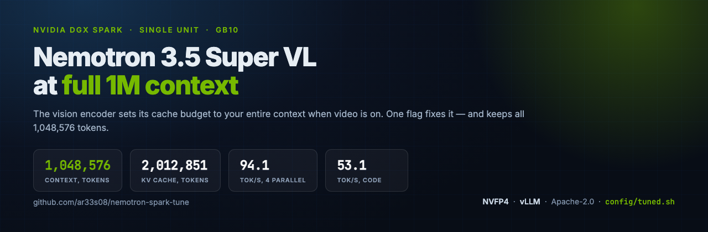
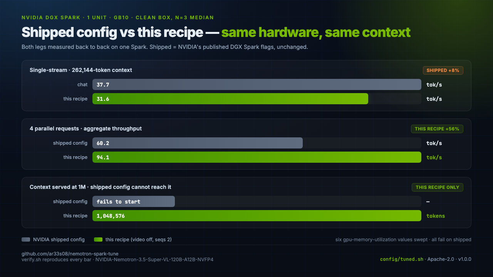

# Nemotron 3.5 Super VL on one DGX Spark

**Serve NVIDIA's Nemotron 3.5 Super VL (120B-A12B, NVFP4) on a single DGX Spark at its full 1,048,576-token context**, through an OpenAI-compatible API — with a one-flag fix for the encoder budget that otherwise stops it from starting.

by [Arees Manesia](https://github.com/ar33s08)



[](https://opensource.org/licenses/Apache-2.0)
[](#requirements)
[](#performance)
[](https://github.com/vllm-project/vllm)

---

Serve **Nemotron 3.5 Super VL** from one NVIDIA DGX Spark (GB10, 121 GB unified memory) with **video and image input** at a **524,288-token context**, or **1,048,576** with video off — with speculative decoding, 596,634-2,012,851 tokens of KV cache, and a one-flag fix for the encoder budget that otherwise stops it starting. It runs vLLM (`nightly-aarch64`) with NVIDIA's own NVFP4 checkpoint and the LiLiCorr drafter.

- Checkpoint: [`nvidia/NVIDIA-Nemotron-3.5-Super-VL-120B-A12B-NVFP4`](https://huggingface.co/nvidia/NVIDIA-Nemotron-3.5-Super-VL-120B-A12B-NVFP4)
- Drafter: `nvidia/NVIDIA-Nemotron-3.5-Super-VL-120B-A12B-NVFP4-LiLiCorr`
- API model id: `nemotron-3.5-super-vl`
- Context: **524,288** with video (default) or **1,048,576** video-off; up to 2,012,851 tokens of KV cache
- One command: `config/tuned.sh` starts it




## The fix

The shipped config leaves `max_model_len` at the model's advertised 1M. When **video input is enabled**, the vision encoder sets its cache budget to the **entire context** (`encoder_budget.py:29` passes `seq_len=max_model_len`), so at 1M it tries to profile 1,048,576 tokens.

Two walls follow, and they are the same root cause seen from two sides:

| context (video on) | what happens |
|---|---|
| 1,048,576 | encoder OOM during profile — engine exits, no KV cache allocated |
| 786,432 | encoder profiling dies partway |
| 524,288 | fits |
| 393,216 @ `util 0.80` | **KV starves** — `needs 11.47 GiB KV, only 4.68 available` |

That last row is the useful one: the encoder cache takes its memory *before* KV cache allocates, so a low `--gpu-memory-utilization` leaves KV with almost nothing and the engine exits.

```python
# nano_nemotron_vl.py:361-363
if mm_counts.get("video", 0) > 0:
    mm_max_tokens["video"] = seq_len        # seq_len == max_model_len
```

The engine confirms the budget itself, on the way down:

```
Encoder cache will be initialized with a budget of 1048576 tokens,
and profiled with 1 video items of the maximum feature size.
```

Two working configurations follow from that — pick by whether you need video:

```bash
# keep video, lower the context, and raise util so KV survives:
--max-model-len 524288 --gpu-memory-utilization 0.90
# or drop video and keep the full 1M:
--max-model-len 1048576 --limit-mm-per-prompt '{"video":0,"image":1}'
```

## Performance

One DGX Spark, clean box, `n=3` median, measured through the OpenAI API.

### This recipe vs the shipped config

| metric | shipped config @262K\* | video OFF, 1M | **video ON, 524K (default)** |
|---|---|---|---|
| chat tok/s | **37.7** | 31.4 | 32.6 |
| code tok/s | 54.3 | 51.0 | **51.7** |
| single-stream mean | **46.0** | 41.2 | **42.2** |
| 2 parallel, aggregate | 60.1 | 83.7 | 85.0 |
| 4 parallel, aggregate | 60.2 | 85.1 | **86.3** |

**Video costs almost nothing.** Serving video at 524,288 measures *faster* than dropping video to reach 1,048,576 (mean 42.2 vs 41.2, conc4 86.3 vs 85.1), so `./start.sh` defaults to video on.

\* The shipped config does not reach 1M, so 262K is the nearest point where it runs.

**Straight read:** the shipped config is ~8% faster single-stream — `seqs=1` does less scheduler work per request. This recipe is **+56% under parallel load**, and is the one that serves the advertised context at all.

### Starting up

| | shipped config @1M | video off @1M | video on @524K |
|---|---|---|---|
| starts | no | **yes** | **yes** |
| context served | — | 1,048,576 | 524,288 |
| KV cache | — | 2,012,851 tok | 596,634 tok |
| video | (can't reach) | no | **yes** |

## Requirements

- One NVIDIA DGX Spark (GB10, 121 GB unified memory), with nothing else large on the GPU — the loader wants ~112 GiB free.
- Docker with the NVIDIA container runtime.
- Both checkpoints pre-downloaded under `HF_HOME`.

## Run

```bash
./start.sh                  # start on the full 1,048,576 context
python3 bench/bench.py      # measure it
./stop.sh                   # stop and free memory
```

`VIDEO=1 ./start.sh` keeps video input (and drops to 262,144 context).

Or reproduce the whole comparison:

```bash
bash verify.sh              # both configs, paired, records both outcomes
bash scripts/basenum.sh     # the three measured legs behind the table
bash scripts/edge.sh        # the six-value gpu-memory-utilization sweep
```

## What was tried, and what did not work

Every row measured. This box varies ±1.5% run to run; anything inside that is called flat.

| attempt | result |
|---|---|
| `--gpu-memory-utilization` 0.60-0.92 **at 1M** with video on | all fail (encoder OOM) |
| `--gpu-memory-utilization` 0.80 **at 393K** with video on | **fails: KV starves, only 4.68 GiB available** |
| `--gpu-memory-utilization` 0.88 / 0.90 at 393K | **works** — 513,228 / 595,824 tok KV |
| `--max-num-batched-tokens` 8192 → 4096 → 2048 | no effect (budget stayed 1048576) |
| `--max-num-batched-tokens 16384` | will not start: needs 12.82 GiB KV, 6.66 available |
| `--mm-processor-kwargs '{"num_frames":64}'` | `TypeError` — not a real kwarg |
| `--mm-processor-kwargs '{"video":...}'` | `TypeError` — flat keys only |
| `--mm-processor-kwargs '{"max_num_tiles":1,"video_pruning_rate":0.9}'` | still OOMs |
| `--async-scheduling` with a 16384 batch | **−27%** |
| `--kv-cache-dtype fp8` | flat — `fp8_e4m3` is already the default |
| drafter `candidate_topk` 8 → 16 | `AssertionError` — the checkpoint's `rank_embedding` is baked at 8 |
| `VLLM_BATCH_INVARIANT=1` | will not start |
| `mamba-ssm-cache-dtype float32` with stochastic rounding | mutually exclusive |

**Stacking the winners made it worse.** `VLLM_MARLIN_USE_ATOMIC_ADD` alone measures **45.0** tok/s; adding a second winning flag drops it to 43.1. Ship one, not a pile. That env var matters because GB10 has no native FP4, so every GEMM routes through Marlin.

### Two things found on the way

**Swap spill.** Stock `min_free_kbytes` is ~44 MB and `swappiness` is 60, so the kernel pages the model out rather than keeping it resident — swap reached 9989 MB during one load and fell to 129 MB after teardown. `config/tuned.sh` dirties and frees an 8 GB buffer before launching to force reclamation, with no root needed.

**`gpu_memory_utilization` is a system setting on unified memory** — a slice of the whole 121 GB rather than dedicated VRAM. At 0.85 it pinned ~108 GB unswappable and wedged the box: `ping` worked and TCP to :22 still accepted, but `sshd` could not fork, so it never sent its banner. Recovery needs the power button.

## Full variant table (18 variants, 3 phases)

Run-to-run variance on this box is **±1.5%** — anything inside that is called flat.

### Phase 1 — scheduling (baseline: mean 38.6 / conc4 27.3)

| variant | mean | code | conc4 | verdict |
|---|---|---|---|---|
| **seqs2 (`--max-num-seqs 2`)** | 39.0 | 57.1 | **37.9** | **WIN** |
| baseline | 38.6 | 57.3 | 27.3 | — |
| async8 (`--async-scheduling`) | 39.5 | 57.0 | 29.4 | flat |
| kvfp8 (`--kv-cache-dtype fp8`) | 38.3 | 56.6 | 28.1 | flat (fp8 already default) |
| async + batch16k | 28.2 | 36.9 | 26.7 | **−27%** |

### Phase 2 — kernel / compile layer (baseline: mean 42.7 / conc4 88.5)

| variant | mean | code | conc4 | verdict |
|---|---|---|---|---|
| **marlin_atomic_add** | **45.0** | **55.7** | 85.2 | **WIN** |
| cudagraph_trim | 44.3 | 54.1 | 87.9 | +3.7% |
| jitwarmup_threads | 44.1 | 53.0 | 85.9 | +3.3% |
| autotune_cache | 43.6 | 53.4 | **94.2** | +6.4% conc4 |
| moe_skip_padding | 42.8 | 53.9 | 87.1 | flat |
| baseline | 42.7 | 51.2 | 88.5 | — |
| max_tokens_expert | 42.0 | 52.4 | 84.4 | −1.6% |
| cudagraph_gc | 40.9 | 48.9 | 89.3 | −4.2% |

### Phase 3 — stacking (baseline: mean 42.7)

| config | mean | verdict |
|---|---|---|
| marlin alone | **45.0** | best |
| combo_all (4 levers) | 43.8 | worse |
| combo_safe (2 levers) | 43.1 | worse |

## Other findings

- LiLiCorr's speculative depth is already maxed at 7 (its `block_size` is 8).
- FlashInfer's autotuner only completes a full pass on an idle box; under contention it silently fell back to `tactic=-1`. The "no tuned config" warnings were a symptom of contention, not a broken kernel.
- `--kv-cache-dtype fp8` is a no-op: `fp8_e4m3` is already the default.

## Honest limitations

- One machine, one model, one serving stack. A different Spark may differ.
- Turning video off is a **behaviour change**, not a free win: you keep the full 1M context but lose video understanding. `--max-model-len 262144` keeps video.
- ±1.5% run-to-run variance; effects below that are labelled flat.
- The phase tables ran under different box-idle conditions, so they are grouped rather than mixed into one headline number.

## Layout

```
start.sh             # start it (full 1M context)
stop.sh              # stop it and free memory
config/tuned.sh      # the fix (video=0) plus tuning flags
config/baseline.sh   # the shipped DGX Spark config, for comparison
verify.sh            # paired A/B, records both outcomes
bench/bench.py       # single-stream + concurrency benchmark (n=3 median)
scripts/             # the individual experiments, kept for the record
```

## License

Apache-2.0

---

Model: [nvidia/NVIDIA-Nemotron-3.5-Super-VL-120B-A12B-NVFP4](https://huggingface.co/nvidia/NVIDIA-Nemotron-3.5-Super-VL-120B-A12B-NVFP4)